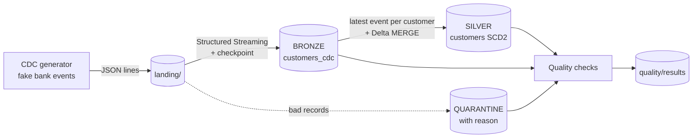

# bank-lakehouse

A local **lakehouse** for a synthetic retail bank. Change-data-capture (CDC) events
from a `customers` table flow through a **Medallion architecture** (bronze → silver)
on **Delta Lake**, with record-level quarantine, full customer history using
**SCD Type 2**, and automated **data quality checks**.

Everything runs on a laptop with free, open-source tools. No cloud account needed.



---

## Table of contents

- [Why this project](#why-this-project)
- [Tech stack](#tech-stack)
- [Project structure](#project-structure)
- [How the pipeline works](#how-the-pipeline-works)
  - [1. CDC data generator](#1-cdc-data-generator)
  - [2. Bronze: raw ingestion with quarantine](#2-bronze-raw-ingestion-with-quarantine)
  - [3. Silver: customer history with SCD Type 2](#3-silver-customer-history-with-scd-type-2)
  - [4. Data quality checks](#4-data-quality-checks)
- [Getting started](#getting-started)
- [Running the pipeline](#running-the-pipeline)
- [Example results](#example-results)
- [Exploring the data](#exploring-the-data)
- [Testing](#testing)
- [Design decisions](#design-decisions)
- [Known limitations](#known-limitations)
- [Roadmap](#roadmap)

---

## Why this project

Banks need to know not only what their data says **now**, but what it said **at any
point in the past**, and they can't afford to silently lose or corrupt records. This
project demonstrates the core patterns that make that possible:

| Problem | Pattern used here |
|---|---|
| Source systems emit inserts, updates and deletes continuously | **CDC** events in a Debezium-style envelope |
| One malformed record shouldn't stop the pipeline, or disappear | **Quarantine table** with a named reason per record |
| Re-running a job must never duplicate data | **Idempotent** writes (streaming checkpoints, Delta transaction IDs, hash comparison) |
| Auditors ask "what was this customer's address in March?" | **SCD Type 2** history with `valid_from` / `valid_to` |
| Data problems should be caught before anyone uses the data | **Quality checks** with `error` / `warn` severity, stored as data |

---

## Tech stack

| Area | Tools |
|---|---|
| Processing | Apache Spark 4.0 (PySpark), Spark Structured Streaming |
| Storage | Delta Lake 4.0 (ACID tables, `MERGE INTO`, time travel) |
| Data generation | Python, Faker |
| Testing | pytest |
| Tooling | Make, Git |
| Runtime | Python 3.12, Java 21, Linux / WSL |

---

## Project structure

```
bank-lakehouse/
├── lakehouse/
│   ├── config.py          # every file path in one place
│   ├── spark.py           # Spark session with Delta Lake enabled
│   ├── generate_data.py   # fake CDC events (inserts, updates, deletes, ~2% corrupted)
│   ├── bronze.py          # streaming ingestion + quarantine
│   ├── silver.py          # SCD Type 2 customer table via Delta MERGE
│   └── quality.py         # data quality checks, results saved to Delta
├── tests/
│   ├── conftest.py        # shared local Spark session for tests
│   ├── test_bronze.py     # parsing and quarantine rules
│   └── test_silver.py     # SCD2 staging logic
├── Makefile               # shortcuts: make demo, make test, ...
├── requirements.txt
└── README.md
```

When the pipeline runs, it creates a `data/` folder (ignored by Git):

```
data/
├── landing/customers/          # raw CDC files from the generator
├── state/generator_state.json  # generator's memory of existing customers
├── checkpoints/                # streaming progress (which files were read)
└── lake/
    ├── bronze/customers_cdc          # Delta table: valid raw events
    ├── bronze/customers_quarantine   # Delta table: rejected lines + reason
    ├── silver/customers              # Delta table: SCD2 customer history
    └── quality/results               # Delta table: every quality check run
```

---

## How the pipeline works

### 1. CDC data generator

`lakehouse/generate_data.py` simulates the change stream a tool like
[Debezium](https://debezium.io/) would capture from a bank's database. Each line is
one change event:

```json
{
  "op": "u",
  "ts_ms": 1767231570689,
  "source": {"db": "bank", "table": "customers"},
  "before": {"customer_id": "C000139", "city": "Saraside", "segment": "retail", ...},
  "after":  {"customer_id": "C000139", "city": "Saraside", "segment": "premier", ...}
}
```

| `op` | Meaning | `before` | `after` |
|---|---|---|---|
| `c` | create (new customer) | `null` | new row |
| `u` | update (changed field) | old row | new row |
| `d` | delete (closed relationship) | old row | `null` |

- **First run:** an initial load of 200 customers (all `c` events).
- **Later runs:** a mix of about 75% updates, 20% new customers and 5% deletes.
- **About 2% of lines are deliberately corrupted** in one of three realistic ways:
  truncated JSON, a missing `customer_id`, or an unknown operation code.
- Output is **deterministic**: the same seed always produces the same data, and the
  generator remembers existing customers between runs in a small state file.

### 2. Bronze: raw ingestion with quarantine

`lakehouse/bronze.py` loads raw events into Delta Lake without changing their meaning.

- **Spark Structured Streaming** watches the landing folder for new files.
- A **checkpoint** records which files have been processed, so running bronze twice
  never loads a file twice.
- `trigger(availableNow=True)` processes everything new and then stops, so the job
  can be scheduled like a batch job while keeping streaming's bookkeeping.
- Each line is parsed against a fixed schema. Records that fail a rule are written
  to a **quarantine table** with the original line and a reason:

| Reason | Example |
|---|---|
| `malformed_json` | a line cut off halfway |
| `unknown_op` | `"op": "x"` |
| `missing_ts` | no event timestamp |
| `missing_customer_id` | no ID in `before` or `after` |
| `missing_after` | a create/update with no new values |

- Writes use Delta's `txnAppId` / `txnVersion` options, so if a micro-batch is
  retried after a crash, Delta skips the duplicate write.

### 3. Silver: customer history with SCD Type 2

`lakehouse/silver.py` turns the event log into a customer table that keeps
**every version** of every customer.

```
customer_id | city   | segment | valid_from          | valid_to            | is_current
C000139     | Austin | retail  | 2026-01-01 01:07:38 | 2026-01-03 14:20:11 | false
C000139     | Tampa  | premier | 2026-01-03 14:20:11 | null                | true
```

How a run works:

1. **Latest event per customer.** A window function keeps the newest event for each
   customer and computes a SHA-256 hash of its attributes (`row_hash`).
2. **Staging trick.** A Delta `MERGE` can either update *or* insert per source row,
   but a change needs *both* (close the old row and add the new one). So changed
   customers are staged **twice**:
   - with `merge_key = customer_id`, which matches the current row and **closes** it;
   - with `merge_key = NULL`, which never matches, so it is **inserted** as the new version.
3. **One atomic `MERGE`:**
   - closes the current row when the event is newer **and** either a delete or a real
     change (different hash);
   - inserts brand-new customers and new versions of changed ones;
   - never inserts a new row for a delete (the old row is closed with
     `closed_by_delete = true`).

Because a row is only closed when the incoming event is **newer and different**,
running silver again on the same data changes nothing. The job is **idempotent**.

### 4. Data quality checks

`lakehouse/quality.py` runs checks on bronze and silver and appends the results to a
Delta table, so data quality can be trended over time.

| Check | Severity | Rule |
|---|---|---|
| `silver_one_current_row_per_customer` | error | no customer has two current rows |
| `silver_customer_id_not_null` | error | every row has an ID |
| `silver_valid_to_after_valid_from` | error | history periods are never negative |
| `silver_current_rows_have_no_valid_to` | error | current rows are open-ended |
| `silver_email_format` | warn | current emails look valid |
| `bronze_quarantine_rate` | warn | under 5% of events quarantined |

If any **error** check fails, the script exits with code `1`, so a scheduler or CI
job would stop the pipeline. **Warnings** are reported but don't stop it.

---

## Getting started

### Requirements

- **Linux or macOS.** On Windows, use **WSL** (Windows Subsystem for Linux), since
  Spark's Python workers are unreliable when run natively on Windows.
- **Java 17 or 21** (Spark 4.0 does not run on Java 24+)
- **Python 3.10 to 3.12**
- Internet access on the first run (Spark downloads the Delta Lake jars from Maven)

### Windows: set up WSL first

In PowerShell (as administrator):

```powershell
wsl --install
```

Restart, open **Ubuntu**, then run everything below inside the Ubuntu terminal.

### Install

```bash
# Ubuntu / WSL: install Java and Python tooling
sudo apt update
sudo apt install -y openjdk-21-jdk python3-venv python3-pip

# get the code
git clone https://github.com/pavithraturlapati/bank-lakehouse.git
cd bank-lakehouse

# create and activate a virtual environment
python3 -m venv .venv
source .venv/bin/activate

# install dependencies
pip install -r requirements.txt
```

Check the setup:

```bash
java -version      # 17 or 21
python --version   # 3.10 - 3.12
make test          # should print: 8 passed
```

---

## Running the pipeline

### One command

```bash
make demo
```

This cleans old data, then runs two full cycles:

1. generate the initial load → bronze → silver
2. generate a batch of changes → bronze → silver → quality checks

### Step by step

```bash
python -m lakehouse.generate_data                 # batch 1: 200 new customers
python -m lakehouse.bronze                        # load batch 1
python -m lakehouse.silver                        # build the customer table

python -m lakehouse.generate_data --changes 50    # batch 2: updates, new, deletes
python -m lakehouse.bronze                        # loads ONLY the new file
python -m lakehouse.silver                        # closes old rows, adds new versions

python -m lakehouse.quality                       # run the checks
```

### All `make` targets

| Command | What it does |
|---|---|
| `make setup` | install dependencies |
| `make generate` | write the first batch (initial load) |
| `make changes` | write the next batch of changes |
| `make bronze` | ingest new files into bronze |
| `make silver` | update the SCD2 customer table |
| `make quality` | run quality checks |
| `make demo` | full end-to-end run from a clean state |
| `make test` | run the unit tests |
| `make clean` | delete all generated data and tables |

Generator options: `--initial` (customers in the first load), `--changes` (events per
later batch), `--corrupt-rate` (default `0.02`), `--seed` (default `42`).

---

## Example results

From a `make demo` run:

```
batch 1: wrote 200 events (4 corrupted) -> customers_batch_0001.json
  micro-batch 0: 196 good, 4 quarantined
silver: 196 rows total, 196 current customers, 0 historical versions

batch 2: wrote 50 events (3 corrupted) -> customers_batch_0002.json
silver: 234 rows total, 206 current customers, 28 historical versions

[PASS] silver_one_current_row_per_customer      failed_rows=0
[PASS] silver_customer_id_not_null              failed_rows=0
[PASS] silver_valid_to_after_valid_from         failed_rows=0
[PASS] silver_current_rows_have_no_valid_to     failed_rows=0
[PASS] silver_email_format                      failed_rows=0
[PASS] bronze_quarantine_rate                   failed_rows=0
```

After batch 2, the table holds **206 current customers** and **28 closed historical
rows** (changed or deleted customers). Running `silver` again prints exactly the same
numbers.

---

## Exploring the data

Open a Python shell inside the project (`python`) and start a session:

```python
from lakehouse.spark import get_spark
spark = get_spark()
silver = spark.read.format("delta").load("data/lake/silver/customers")
```

**See a customer's full history:**

```python
changed = silver.where("is_current = false").select("customer_id").limit(3)
(silver.join(changed, "customer_id")
       .orderBy("customer_id", "valid_from")
       .select("customer_id", "city", "email", "segment", "valid_from", "valid_to", "is_current")
       .show(truncate=False))
```

**Point-in-time query: who were our customers at a given moment?**

```python
from pyspark.sql import functions as F
as_of = F.lit("2026-01-01 12:00:00").cast("timestamp")
snapshot = silver.where((F.col("valid_from") <= as_of) &
                        (F.col("valid_to").isNull() | (F.col("valid_to") > as_of)))
snapshot.count()
```

**Inspect quarantined records:**

```python
q = spark.read.format("delta").load("data/lake/bronze/customers_quarantine")
q.groupBy("_quarantine_reason").count().show()
q.select("_quarantine_reason", "raw_line").show(truncate=80)
```

**Delta time travel: the table as it was before batch 2:**

```python
spark.read.format("delta").option("versionAsOf", 0).load("data/lake/silver/customers").count()
```

**Quality check history:**

```python
spark.read.format("delta").load("data/lake/quality/results").orderBy("run_ts").show(truncate=False)
```

### Things to try

- **Run `make bronze` twice in a row.** The second run loads nothing, because the
  checkpoint remembers processed files.
- **Run `make silver` twice in a row.** Row counts don't change, because the MERGE is
  idempotent.
- **Raise the corruption rate:** `python -m lakehouse.generate_data --changes 50 --corrupt-rate 0.2`,
  then run bronze and quality to see the quarantine-rate warning trigger.

---

## Testing

```bash
make test            # or: python -m pytest -v
```

The 8 unit tests run on a plain local Spark session (no Delta needed), so they are
fast. They cover:

- **Bronze:** valid events pass; deletes take their ID from `before`; each corruption
  type lands in quarantine with the right reason.
- **Silver:** the latest event wins; new customers are staged once; changed customers
  are staged twice; re-running with the same data stages no new version; deletes
  never insert a new row.

The parsing and staging logic is kept in pure functions (`split_records`,
`latest_events`, `build_staged`) separate from file I/O, which is what makes it
testable without real tables.

---

## Design decisions

- **Quarantine instead of fail-fast.** One bad record shouldn't stop a bank's
  pipeline, but it must never disappear silently either. Every rejected line is kept
  with its reason and source file.
- **ANSI mode on (`spark.sql.ansi.enabled=true`).** Spark raises errors on invalid
  casts instead of quietly returning `null`, so bad data is handled explicitly at the
  edge rather than hidden.
- **Idempotency at every layer.** Streaming checkpoints (bronze files), Delta
  transaction IDs (bronze writes) and hash comparison (silver MERGE) mean any step
  can be safely re-run after a failure.
- **Hash-based change detection.** Comparing one `row_hash` is cheaper and simpler
  than comparing every column, and new attributes only need adding to one list.
- **Quality results as data.** Saving each run to a Delta table makes it possible to
  trend quality over time or alert on it, rather than relying on console output.
- **UTC everywhere.** The Spark session time zone is fixed to UTC so timestamps mean
  the same thing on every machine.

---

## Known limitations

- **One change per customer per silver run.** If a single run sees several changes
  for the same customer, only the latest becomes a history row. A production version
  would apply the changes in order.
- **Silver reads the whole bronze table each run.** Fine at this scale; a larger
  system would process only new bronze rows (for example with Delta Change Data Feed).
- **Single table.** Only `customers` is modeled so far.
- **Local only.** Runs on one machine; there is no orchestration or cloud deployment yet.

---

## Roadmap

- [ ] **Phase 1:** CDC generator, bronze streaming + quarantine, silver SCD2, quality checks, unit tests
- [ ] **Phase 2:** `transactions` table, gold aggregates, dbt + DuckDB analytics models
- [ ] **Phase 3:** pipeline metrics table, LLM-written incident summaries, RAG over the docs
- [ ] **Phase 4:** Kafka (Redpanda) transport, GitHub Actions CI, Airflow/Dagster orchestration
